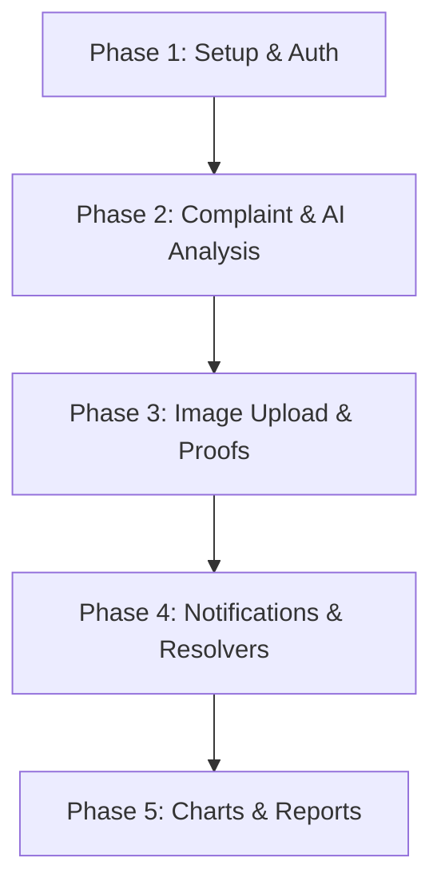

# Project Phase Roadmap

This document outlines the scope of work and milestones for all five phases of the Smart Complaint Analyzer system.

---

---

## Phase 1: Foundation & Authentication (Current)
* **Goal**: Establish clean architectures, routers, DB models, themes, and registration pipelines.
* **Scope**: Firebase Auth, Google Sign-In, sync profiles in MongoDB, registration logic including register number extraction from `@klnce.edu` domain emails.

## Phase 2: Complaint Management & AI classification
* **Goal**: Enable complaint filing and integrate Google Gemini AI.
* **Scope**: Complaint model creation, Gemini integration for classification, sentiment analysis, priority detection, AI summaries, and proposed resolution templates.

## Phase 3: Cloud Asset Integration (Cloudinary & GridFS)
* **Goal**: Manage binary assets, image uploads, and documents.
* **Scope**: Direct photo uploads from Flutter to Cloudinary via unsigned presets, PDF file attachments managed inside MongoDB GridFS storage.

## Phase 4: Push Alert Systems & Resolution Proofs
* **Goal**: Keep users informed on grievance status changes.
* **Scope**: OneSignal push notifications and native local alerts. Resolution upload requirements (visual proof) for department staff.

## Phase 5: PDF Reports, Analytics & Auditing
* **Goal**: Provide administrative overviews and exportable stats.
* **Scope**: Interactive charts using `fl_chart`, PDF generation using `pdf` and `printing` libraries, and system administrator dashboards.
